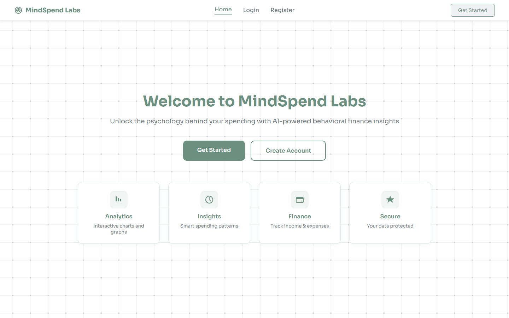

# MindSpend Labs

Behavioural finance analytics: upload your transactions and see the patterns behind your everyday spending, not just the total.

**Live:** [mindspend-labs.vercel.app](https://mindspend-labs.vercel.app/welcome.html)



## What it does

- **Ingestion:** parses uploaded transaction data and categorises each transaction.
- **Analysis:** detects spending patterns and generates insights and summaries.
- **Challenges:** suggests spending challenges based on your habits.
- **Export:** downloads an analytics report as a PDF, or exports to Google Sheets.
- **Accounts:** registration, login with JWT access and refresh tokens, password reset, and account deletion.

## Stack

| Part | Tech |
|---|---|
| Frontend | HTML, CSS, JavaScript (deployed on Vercel) |
| Backend | Python, FastAPI, SQLAlchemy, PostgreSQL (deployed on Render) |
| Auth | python-jose (JWT), passlib/bcrypt, slowapi rate limiting |
| Reports | ReportLab (PDF), Google Sheets integration |

## Run locally

```bash
cd backend
python -m venv .venv
.venv/Scripts/activate        # macOS/Linux: source .venv/bin/activate
pip install -r requirements.txt
cp .env.example .env          # then fill in the values
uvicorn main:app --reload
```

Open `frontend/welcome.html` in a browser, or serve the `frontend/` folder with any static server.

## Project layout

```
backend/
  api/, routes/, auth/    HTTP endpoints and authentication
  ingestion/              transaction parsing
  categorizer/            transaction categorisation
  analysis/, insights/    pattern detection and insight generation
  challenges/             spending challenge engine
  integrations/           Google Sheets, Firebase and Gemini clients
frontend/                 static pages and components
render.yaml               Render deployment config for the API
```
